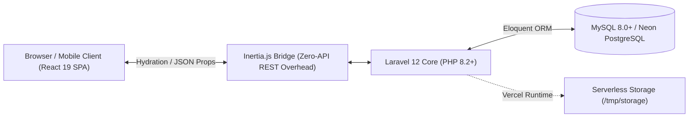

<div align="center">
  

  # 📚 EDUSYNC — Enterprise School Management & Scheduling System

  <p>
    <em>Sistem Informasi Manajemen Sekolah, Jadwal Pelajaran Dinamis, dan Monitoring KBM Real-time Berbasis Standar Kurikulum Merdeka & Dapodik SMK Kejuruan.</em>
  </p>

  <p>
    
    
    
    
    
    
    
    
    
    
  </p>
</div>

---

## 📌 Daftar Isi
1. [Tentang EduSync](#-tentang-edusync)
2. [Fitur Unggulan Sistem](#-fitur-unggulan-sistem)
3. [Arsitektur & Tech Stack](#-arsitektur--tech-stack)
4. [Struktur Direktori Proyek](#-struktur-direktori-proyek)
5. [Akun Bawaan & Kredensial Demo](#-akun-bawaan--kredensial-demo)
6. [Panduan Instalasi Lokal](#-panduan-instalasi-lokal)
7. [Pengujian Otomatis (Testing)](#-pengujian-otomatis-testing)
8. [Panduan Deployment Cloud](#-panduan-deployment-cloud)
9. [Kontribusi & Lisensi](#-kontribusi--lisensi)

---

## 📖 Tentang EduSync

**EduSync** adalah platform tata kelola operasional dan akademik sekolah tingkat enterprise yang dirancang khusus untuk mengatasi kompleksitas penjadwalan pelajaran dan pemantauan pembelajaran pada institusi pendidikan kejuruan (SMK) maupun sekolah menengah atas.

Mengacu pada regulasi struktur kurikulum nasional (**Kurikulum Merdeka**) dan integrasi data **Dapodik Kejuruan**, EduSync menyederhanakan siklus operasional harian yang sebelumnya rawan kesalahan manual:

* **Pencegahan Bentrok Jadwal Otomatis (Anti-Clash Engine):** Menghindari tabrakan guru ganda pada jam pelajaran yang sama serta memastikan kapasitas ruang teori atau bengkel praktik vokasi tidak melebihi kuota.
* **Monitoring KBM Real-time (Radar Kelas):** Memberikan visibilitas langsung terhadap status kehadiran guru, keterisian ruang kelas, jam kosong terarah (*inval*), dan aktivitas pembelajaran harian.
* **Rekapitulasi Cepat & Legalitas Cetak:** Mengotomatiskan laporan presensi siswa, guru, serta denda kas kebersihan dalam format cetak PDF berstandar resmi (Kop Surat Sekolah & NIP legal) dan ekspor CSV/Excel.
* **Arsitektur Tanpa Reload (Single Page Application):** Memanfaatkan kombinasi Laravel 12 dan React 19 via Inertia.js untuk perpindahan halaman yang instan tanpa membebani server.

---

## ✨ Fitur Unggulan

### 1. 🎛️ Admin Dashboard & Manajemen Master Data
* **Pusat Kendali Kurikulum:** Ringkasan metrik sekolah secara langsung meliputi total guru aktif, jumlah siswa terdaftar rombel, bengkel/lab, dan rasio kehadiran harian.
* **Sinkronisasi Master Dapodik:** Pengelolaan data guru, siswa, kelas/rombel, kompetensi keahlian/jurusan SMK, mata pelajaran, dan slot jam pelajaran (JP).
* **Manajemen Ruang & Relokasi Kelas:** Pemetaan alokasi ruang kelas teori dan laboratorium vokasi secara fleksibel.
* **Verifikasi Akun Baru:** Sistem persetujuan (*Approve/Reject*) pendaftaran akun mandiri guru dan siswa sebelum diberikan akses ke portal.

### 2. 📅 Penjadwalan Dinamis (Dynamic Scheduling)
* **Schedule Builder Interaktif:** Penyusunan matriks jadwal mingguan per kelas dan per guru berbasis drag-and-drop atau input terstruktur.
* **Conflict Detector:** Deteksi instan jika seorang guru dijadwalkan mengajar di dua kelas berbeda pada hari dan jam yang sama.
* **Auto-Generate Jadwal:** Generator jadwal terotomatisasi berdasarkan beban jam linear guru dan ketersediaan ruangan.
* **Import & Ekspor PDF Jadwal:** Kemampuan memindai (*parsing*) jadwal dari dokumen PDF serta mencetak jadwal resmi per kelas.

### 3. 📡 Monitoring KBM Real-time & Inval Guru
* **KBM Live Radar:** Pemantauan langsung status tiap kelas (KBM Aktif, Istirahat, Jam Kosong, atau Guru Piket Pengganti).
* **Alur Pengajuan Inval & Tukar Jadwal:** Guru yang berhalangan dapat mengajukan pertukaran jam mengajar secara transparan dengan persetujuan admin kurikulum.
* **Surat Tugas Keluar Dinas:** Manajemen disposisi izin dinas luar guru lengkap dengan pelacakan status bertugas.
* **Penugasan Mandiri (Jamkos Terarah):** Guru berhalangan dapat menyematkan instruksi tugas belajar mandiri agar siswa tetap produktif di kelas.

### 4. 📊 Rekapitulasi & Ekspor Laporan (Recap Export)
* **Kop Surat Kedinasan:** Format cetak PDF resmi lengkap dengan Kop Surat Provinsi Jawa Barat, Cabang Dinas Pendidikan, identitas SMKN 1 Ciomas, serta blok tanda tangan Kepala Sekolah.
* **Isolasi Cetak Otomatis:** Antarmuka web otomatis menyembunyikan sidebar, navbar, dan tombol aksi saat mode cetak (`Ctrl + P`) aktif.
* **Format Tanggal Baku:** Menampilkan tanggal dalam format lokal Indonesia (`DD MMMM YYYY`), bukan format ISO mentah.
* **Dukungan Multi-Dataset:** Rekapitulasi presensi siswa, kehadiran guru, dan rekap denda kebersihan 5R dengan filter rentang tanggal.

### 5. 🛡️ Keamanan & Audit Logs
* **Audit Trail Lengkap:** Pencatatan otomatis setiap aksi penting di sistem (login demo, penyesuaian status presensi, mutasi kelas, persetujuan izin, dan cetak laporan) lengkap dengan alamat IP dan stempel waktu presisi (hingga detik WIB).
* **Filter Log Presisi:** Filter riwayat aktivitas menggunakan pemilih tanggal dan waktu (`datetime-local`) beserta tombol preset (*Hari Ini*, *7 Hari*, *30 Hari*).
* **Keamanan Akses Berjenjang:** Pembatasan akses berbasis peran (`admin`, `guru`, `siswa`) melalui middleware Laravel.

### 6. ⚡ UX Modern, Responsif & Anti-Slop
* **Navigasi SPA Ringan:** Transisi halaman tanpa kedip berkat Inertia.js dan React 19.
* **Penomoran Urut & Pagination:** Komponen pagination terpadu yang membatasi beban memori per halaman (15 baris per halaman) dengan nomor urut berkesinambungan.
* **Dukungan Mode Gelap (Dark Mode):** Tampilan otomatis menyesuaikan preferensi sistem operasi atau pengaturan tema pengguna.
* **Responsif Seluler:** Seluruh tata letak tabel, kartu monitoring, dan form dioptimalkan untuk kenyamanan navigasi layar ponsel.

---

## 🛠️ Arsitektur & Tech Stack



| Kategori | Teknologi | Versi | Peran & Kegunaan dalam Sistem |
|---|---|---|---|
| **Backend Framework** | Laravel | `12.x` | Routing, ORM Eloquent, otentikasi sesi, middleware otorisasi, dan penjadwalan cron. |
| **Bahasa Backend** | PHP | `^8.2` | Engine runtime server-side berkemampuan tinggi. |
| **Frontend Framework** | React | `^19.3` | Pembangunan antarmuka interaktif berbasis komponen modern. |
| **Fullstack Adapter** | Inertia.js | `^3.7` | Penghubung frontend React dengan backend Laravel tanpa perlunya REST API manual. |
| **Styling & Desain** | Tailwind CSS | `^4.0` | Desain utilitas modern, responsif seluler, dan dukungan penuh mode gelap. |
| **Bundler & Tooling** | Vite | `^6.0` | Kompilasi aset frontend super cepat dengan Hot Module Replacement (HMR). |
| **Database** | MySQL / PostgreSQL | `8.0+` / `16+` | Penyimpanan relasional master data, transaksi jadwal, dan audit log. |
| **Pengujian (Testing)** | PHPUnit | `^11.5` | Rangkaian automated unit testing dan feature testing logika bisnis. |
| **PDF Generation** | DomPDF / Smalot | `^3.1` | Pembuatan dokumen presensi cetak dan parsing jadwal pelajaran PDF. |
| **Komponen UI & Ikon** | Lucide React, Chart.js | `Latest` | Visualisasi grafik analitik presensi dan set ikon standar industri. |

---

## 📂 Struktur Direktori Proyek

```text
edusync/
├── api/
│   └── index.php                 # Serverless entry point untuk deployment Vercel
├── app/
│   ├── Http/
│   │   ├── Controllers/          # AdminController, AuthController, StudentController, dll.
│   │   └── Middleware/           # CheckRole, HandleInertiaRequests, TrackUserActivity
│   └── Models/                   # 21 Eloquent Models (AuditLog, Schedule, User, dll.)
├── bootstrap/
│   └── app.php                   # Konfigurasi middleware, exception handler, & storage path
├── config/                       # Konfigurasi app, database, session, & cache
├── database/
│   ├── migrations/               # Skema tabel database relasional
│   └── seeders/                  # Seeder data master, user demo, dan jadwal contoh
├── public/                       # Berkas statis publik & output build Vite
├── resources/
│   ├── css/
│   │   └── app.css               # Entri Tailwind CSS v4 & kustom utilitas
│   ├── js/
│   │   ├── Components/           # Komponen UI (Modal, Pagination, SincBot, ConflictBanner)
│   │   ├── Layouts/              # AdminLayout, TeacherLayout, StudentLayout
│   │   ├── Pages/
│   │   │   ├── Admin/            # Dashboard, AuditLogs, RecapExport, ScheduleBuilder, dll.
│   │   │   ├── Auth/             # Form Login & Registrasi
│   │   │   ├── Student/          # Portal Belajar & Presensi Siswa / Ketua Kelas
│   │   │   └── Teacher/          # Ruang Kerja & Presensi Harian Guru
│   │   └── utils/                # Helper pemformatan tanggal, waktu, dan penomoran
│   └── views/                    # Root Blade template (app.blade.php) & template cetak PDF
├── routes/
│   ├── console.php               # Perintah terjadwal Artisan (cron midnight reset)
│   └── web.php                   # Definisi rute aplikasi terproteksi middleware
├── tests/
│   ├── Feature/                  # Pengujian integrasi alur bisnis, izin, dan jadwal
│   └── Unit/                     # Pengujian unit fungsi dasar
├── phpunit.xml                   # Konfigurasi automated testing
├── render.yaml                   # Blueprint deployment ke Render.com
├── tailwind.config.js            # Konfigurasi tema dan ekstensi Tailwind
└── vercel.json                   # Konfigurasi serverless runtime Vercel & rewrite rules
```

---

## 🔑 Akun Bawaan & Kredensial Demo

Setelah menjalankan seeder database, sistem menyediakan akun demo siap pakai untuk setiap peran:

| Peran (Role) | Email | Kata Sandi Bawaan | Deskripsi Akses |
|---|---|---|---|
| **Admin Kurikulum** | `admin@edusync.sch.id` | `password` | Akses penuh master data, jadwal, audit trail, dan rekapitulasi. |
| **Guru Pengampu** | `guru@edusync.sch.id` | `password` | Presensi mandiri, tukar jam mengajar (inval), dan penugasan KBM. |
| **Guru Wali Kelas** | `wali@edusync.sch.id` | `password` | Persetujuan izin siswa kelas bimbingan dan pantauan piket. |
| **Ketua Kelas (Siswa)** | `siswa@edusync.sch.id` | `password` | Input presensi harian rombel, unduh rekap kelas, dan lapor kebersihan. |
| **Siswa Reguler** | `siswabiasa@edusync.sch.id` | `password` | Cek jadwal pelajaran, pengajuan izin pribadi, dan unggah bukti piket. |

> 💡 **Fitur Quick Login:** Pada halaman login pengujian, tersedia tombol **1-Klik Demo Login** untuk beralih peran secara instan tanpa mengetik manual.

---

## 🚀 Panduan Instalasi Lokal

Ikuti langkah-langkah berikut untuk menjalankan EduSync di komputer lokal:

### 1. Prasyarat Sistem
* **PHP:** Versi `>= 8.2` (ekstensi `pdo`, `pdo_mysql` atau `pdo_pgsql`, `mbstring`, `zip`, `gd`, `bcmath` harus aktif).
* **Composer:** Versi `2.x`.
* **Node.js & NPM:** Versi `18.x` atau `20.x` LTS.
* **Database:** MySQL `8.0+` atau MariaDB / PostgreSQL.

### 2. Langkah Pemasangan

```bash
# 1. Klon repositori dari GitHub
git clone https://github.com/itsvin-debug/EduSync.git
cd EduSync

# 2. Pasang dependensi PHP (Composer)
composer install

# 3. Pasang dependensi JavaScript (NPM)
npm install

# 4. Buat salinan konfigurasi environment
cp .env.example .env

# 5. Generate application key
php artisan key:generate
```

### 3. Konfigurasi Database
Buka file `.env` menggunakan teks editor Anda, lalu sesuaikan koneksi database lokal:

```env
DB_CONNECTION=mysql
DB_HOST=127.0.0.1
DB_PORT=3306
DB_DATABASE=edusync_db
DB_USERNAME=root
DB_PASSWORD=
```

### 4. Migrasi & Seeding Data
Jalankan migrasi skema tabel beserta data awal bawaan:

```bash
php artisan migrate --seed
```

### 5. Menjalankan Server Pengembangan
Anda dapat menjalankan server menggunakan perintah bawaan:

```bash
# Terminal 1: Jalankan backend Laravel
php artisan serve

# Terminal 2: Jalankan Vite HMR
npm run dev
```

*Aplikasi kini dapat diakses melalui peramban di:* **`http://localhost:8000`**

<details>
<summary>⚡ <strong>Opsi Cepat: Menjalankan Sekaligus dengan <code>composer run dev</code></strong></summary>

Proyek ini telah dikonfigurasi dengan `concurrently`. Anda cukup menjalankan satu perintah berikut di terminal:

```bash
composer run dev
```

Perintah ini akan menyalakan server Laravel, antrean queue, log pail, dan Vite development server secara simultan dalam satu jendela terminal.
</details>

---

## 🧪 Pengujian Otomatis (Testing)

EduSync dilengkapi rangkaian automated test yang mencakup pengujian izin akses antar peran, integritas matriks jadwal, pencegahan bentrok, dan validasi rekonsiliasi presensi:

```bash
# Menjalankan seluruh pengujian (29 tests)
php artisan test
```

Contoh keluaran pengujian yang valid:
```text
   PASS  Tests\Unit\ExampleTest
   PASS  Tests\Feature\BusinessLogicAuditTest
   PASS  Tests\Feature\CrossRoleSyncTest
   PASS  Tests\Feature\SincBotTest

  Tests:    29 passed (103 assertions)
  Duration: 10.50s
```

---

## ☁️ Panduan Deployment Cloud

<details>
<summary>🌐 <strong>A. Panduan Deployment ke Vercel & Neon PostgreSQL (Serverless)</strong></summary>

Repositori ini sudah dioptimalkan untuk berjalan di Vercel menggunakan `vercel-php` runtime:

1. **Buat Database Gratis di [Neon.tech](https://neon.tech):**
   * Buat project baru dan pilih region terdekat (misal: Singapore).
   * Catat *Connection String* atau kredensial host PostgreSQL Anda.
2. **Jalankan Migrasi ke Cloud Neon (dari komputer lokal):**
   * Sesuaikan sementara `.env` lokal ke koneksi Neon, lalu jalankan:
     ```bash
     php artisan migrate --force
     php artisan db:seed --force
     ```
3. **Import Repositori di Vercel:**
   * Di dashboard Vercel, pilih **Add New... -> Project**, lalu import repo `itsvin-debug/EduSync`.
   * Pada bagian **Environment Variables**, tambahkan:
     * `APP_NAME` = `EDUSYNC`
     * `APP_KEY` = `(Salin dari .env lokal Anda)`
     * `DB_CONNECTION` = `pgsql`
     * `DB_HOST` = `(Host Neon Anda, contoh: ep-xxx-pooler.c-8.us-east-2.aws.neon.tech)`
     * `DB_PORT` = `5432`
     * `DB_DATABASE` = `neondb`
     * `DB_USERNAME` = `neondb_owner`
     * `DB_PASSWORD` = `(Password database Neon Anda)`
     * `DB_SSLMODE` = `require`
4. **Deploy:**
   * Klik tombol **Deploy**. Vercel akan mengompilasi aset frontend secara otomatis dan menyajikan aplikasi via serverless function.
</details>

<details>
<summary>🐳 <strong>B. Panduan Deployment ke Render.com (Docker Web Service)</strong></summary>

Berkas blueprint [`render.yaml`](render.yaml) telah disediakan di root proyek:
1. Hubungkan akun GitHub Anda ke [Render.com](https://render.com).
2. Buat **New Blueprint Instance** dan arahkan ke repositori ini.
3. Render akan membaca `render.yaml` dan membangun container Docker secara otomatis dengan variabel lingkungan yang telah disesuaikan.
</details>

---

## 🤝 Kontribusi & Lisensi

Kontribusi dan masukan untuk pengembangan EduSync sangat kami hargai. Silakan ikuti panduan berikut:

1. **Fork** repositori ini ke akun GitHub Anda.
2. Buat branch fitur baru (`git checkout -b feature/NamaFiturKeren`).
3. Lakukan commit perubahan Anda (`git commit -m "feat: tambahkan fitur X"`).
4. Pastikan semua automated test tetap lolos (`php artisan test`).
5. **Push** branch Anda (`git push origin feature/NamaFiturKeren`).
6. Buka **Pull Request** ke branch `main`.

### Lisensi
Aplikasi ini dilisensikan di bawah lisensi terbuka [MIT License](LICENSE). Hak Cipta &copy; 2026 **EDUSYNC Development Team**.
